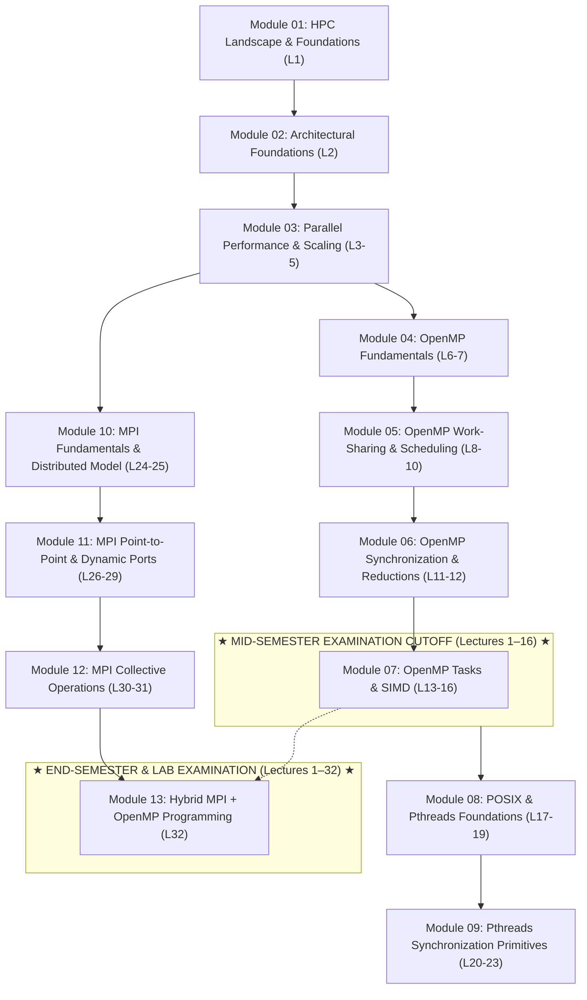

# Parallel Programming & High-Performance Computing (HPC)
## Complete Course Learning Roadmap & Master Curriculum

**Academic Level:** University Undergraduate / Graduate (3rd Year CS/CE)  
**Total Lectures:** 32 Lectures (Lectures 1–16: MidSem | Lectures 17–32: EndSem)  
**Evaluation Scheme:** End Semester Exam: 40% | Lab Exam: 40% | Mid Semester Exam: 20%  
**Single Source of Truth for Syllabus:** `input_syllabus/HPC_Course_Syllabus.pdf`  
**Single Source of Truth for Pedagogy:** `reference/teaching_style_sample.md`  
**Root Output Directory:** `study/`

---

## 1. Course Architecture & Pedagogical Philosophy

Parallel computing is not merely an API or a collection of library functions; it is a fundamental shift in algorithmic thinking forced by the physical limits of semiconductor hardware. This course takes a student from bare silicon foundations up to petascale distributed supercomputing.

### The Two Major Divisions
```
┌─────────────────────────────────────────────────────────────────────────────────┐
│                     PARALLEL PROGRAMMING COURSE ARCHITECTURE                    │
└─────────────────────────────────────────────────────────────────────────────────┘
                                         │
        ┌────────────────────────────────┴────────────────────────────────┐
        ▼                                                                 ▼
┌───────────────────────────────────────────┐ ┌───────────────────────────────────────────┐
│    PART A: TILL MIDSEM (Lectures 1–16)     │ │    PART B: AFTER MIDSEM (Lectures 17–32)   │
│  Foundations, Scaling & Shared-Memory     │ │ Distributed Memory, Pthreads & Hybrid     │
│             (OpenMP)                      │ │           (Pthreads, MPI, Hybrid)         │
├───────────────────────────────────────────┤ ├───────────────────────────────────────────┤
│ • Module 01: HPC Landscape & Dwarfs       │ │ • Module 08: POSIX & Pthreads             │
│ • Module 02: Architectural Foundations    │ │ • Module 09: Pthreads Synchronization     │
│ • Module 03: Performance, Amdahl & Scaling│ │ • Module 10: MPI Fundamentals & Env       │
│ • Module 04: OpenMP Architecture & Basics │ │ • Module 11: MPI Point-to-Point & Dynamic │
│ • Module 05: OpenMP Work-Sharing & Sched  │ │ • Module 12: MPI Collective Operations    │
│ • Module 06: OpenMP Synchronization       │ │ • Module 13: Hybrid MPI + OpenMP          │
│ • Module 07: OpenMP Tasks & SIMD          │ │                                           │
└───────────────────────────────────────────┘ └───────────────────────────────────────────┘
```

---

## 2. Structural Breakdown: Modules and Subtopics

The syllabus covers 32 lectures divided into 13 coherent thematic modules. Every lecture topic has a dedicated folder, and every key subtopic is housed in an independent, fully realized Markdown study file.

### Summary Table of Modules

| Module ID | Module Title | Lectures | Examination Period | Subtopics / Files | Core Technical Focus |
|:---|:---|:---:|:---:|:---:|:---|
| **01** | HPC Foundations & Landscape | 1 | MidSem | 4 Files | Supercomputing, Seven Dwarfs, TOP500, FLOP/s, Power Wall |
| **02** | Architectural Foundations | 2 | MidSem | 5 Files | Pipelining, ILP, SMT, SIMD, Caches, Flynn's Taxonomy, ccNUMA |
| **03** | Parallel Performance & Scaling | 3–5 | MidSem | 5 Files | Amdahl's Law, Gustafson's Law, Overhead, Bottlenecks, Benchmarking |
| **04** | OpenMP Fundamentals | 6–7 | MidSem | 3 Files | Fork-Join, Pragmas, Parallel Regions, Data Scoping, `default(none)` |
| **05** | OpenMP Work-Sharing & Scheduling | 8–10 | MidSem | 4 Files | `#pragma omp for`, `sections`, `single`, Static/Dynamic/Guided Sched |
| **06** | OpenMP Synchronization | 11–12 | MidSem | 5 Files | Race Conditions, `critical`, `atomic`, Barriers, Locks, Reductions |
| **07** | OpenMP Tasks & SIMD | 13–16 | MidSem | 6 Files | Task Parallelism, `taskloop`, SIMD Vectorization, Scoping, Alignment |
| **08** | POSIX Threads (Pthreads) | 17–19 | EndSem | 5 Files | `pthread_t`, `pthread_create`, Attributes, Join/Detach, Stack Sizes |
| **09** | Pthreads Synchronization | 20–23 | EndSem | 6 Files | Mutexes, Condition Variables, Semaphores, RW-Locks, Spinlocks |
| **10** | MPI Fundamentals & Environment | 24–25 | EndSem | 4 Files | Distributed Memory, SPMD, `MPI_Init`, Communicators, `mpicc`/`mpirun` |
| **11** | MPI Point-to-Point & Dynamic Ports| 26–29 | EndSem | 5 Files | Blocking Send/Recv, Non-blocking `MPI_Isend`, Dynamic Ports, ompi-server |
| **12** | MPI Collective Operations | 30–31 | EndSem | 5 Files | `MPI_Bcast`, `MPI_Scatter`, `MPI_Gather`, `MPI_Reduce`, `MPI_Barrier` |
| **13** | Hybrid MPI + OpenMP Programming | 32 | EndSem | 5 Files | Cluster Architecture, Thread Hierarchy, Thread Safety, Hybrid Sum |
| **TOTAL** | **13 Modules** | **32 L** | **Full Year** | **62 Files** | **100% Complete Syllabus Coverage** |

---

## 3. Detailed Curriculum & Subtopic Mapping

### PART A: TILL MIDSEM (Lectures 1–16)

#### Module 01: HPC Foundations & Landscape (Lecture 1)
*Folder:* `study/01_HPC_Foundations/`
- **01_Introduction_and_HPC_Landscape.md**
  - Course roadmap, syllabus overview, evaluation scheme (EndSem 40%, Lab 40%, MidSem 20%).
  - What is High-Performance Computing (HPC)?
  - Evolution from single-core scaling to massively parallel supercomputers.
  - Scientific, industrial, and societal HPC applications (climate modeling, molecular dynamics, astrophysics, AI training).
- **02_Seven_Dwarfs_of_Numerical_Methods.md**
  - The Berkeley "Seven Dwarfs" concept (Colella / Asanović et al.): computational motifs defining HPC workloads.
  - Detailed study of each dwarf: Dense Linear Algebra, Sparse Linear Algebra, Spectral Methods (FFT), N-Body Methods, Structured Grids, Unstructured Grids, Monte Carlo / MapReduce.
  - Architectural implications of each dwarf (compute-bound vs. memory-bound).
- **03_Parallel_Hardware_Hierarchy_and_TOP500.md**
  - Parallel hardware hierarchy: Instruction level $\rightarrow$ Vector/SIMD $\rightarrow$ Sockets/Cores $\rightarrow$ Shared-memory nodes $\rightarrow$ Distributed clusters.
  - The TOP500 list: history, LINPACK benchmark (HPL), High Performance Conjugate Gradients (HPCG).
  - Green500 and energy-efficient supercomputing metrics.
- **04_Performance_Metrics_FLOPS_and_Power_Cost.md**
  - Performance formulation: $P = \text{Work} / \text{Time}$.
  - Floating-point operations per second (FLOP/s): MFLOP/s, GFLOP/s, TFLOP/s, PFLOP/s, EFLOP/s.
  - Theoretical peak performance vs. sustained/effective performance.
  - Power-cost case study: The Power Wall, thermal design power (TDP), megawatt datacenter costs, FLOPS/Watt trade-offs.

---

#### Module 02: Architectural Foundations for Parallelism (Lecture 2)
*Folder:* `study/02_Architectural_Foundations/`
- **01_Stored_Program_Model_and_Pipelining.md**
  - Von Neumann / Stored-program architecture: Instruction Fetch, Decode, Execute, Memory, Write-back.
  - Instruction execution vs. data movement: The Von Neumann bottleneck and the Memory Wall.
  - Instruction pipelining principles: pipeline stages, latency, throughput, pipeline hazards (structural, data, control).
  - Pipeline speedup derivations and limits.
- **02_ILP_Superscalar_and_SMT.md**
  - Instruction-Level Parallelism (ILP): definition, dependency chains, Bernstein's conditions.
  - Superscalar execution: multiple issue units, out-of-order (OoO) execution, branch prediction, speculative execution.
  - Simultaneous Multithreading (SMT) / Intel Hyper-Threading: sharing execution pipelines across hardware thread contexts.
  - Physical cores vs. logical threads: when SMT helps and when it causes cache contention.
- **03_SIMD_Registers_and_Vector_Extensions.md**
  - Single Instruction, Multiple Data (SIMD) concept: parallel arithmetic on wide registers.
  - Evolution of x86 SIMD: MMX $\rightarrow$ SSE (128-bit) $\rightarrow$ AVX/AVX2 (256-bit) $\rightarrow$ AVX-512 (512-bit).
  - Vector registers, vector packing, lane operations, and throughput benefits.
- **04_Memory_Hierarchy_and_Bandwidth.md**
  - Memory hierarchy pyramid: Registers $\rightarrow$ L1 Data/Instruction $\rightarrow$ L2 $\rightarrow$ L3 Shared Cache $\rightarrow$ Main Memory (DRAM) $\rightarrow$ NVRAM/SSD.
  - Cache organization: cache lines (64 bytes), spatial and temporal locality.
  - Memory latency vs. memory bandwidth: bytes-per-flop ratio, memory saturation.
- **05_Flynn_Taxonomy_and_Memory_Architectures.md**
  - Flynn's classical taxonomy (1972): SISD, SIMD, MISD, MIMD with real-world computer examples.
  - Memory architectures: Uniform Memory Access (UMA / SMP) vs. Cache-Coherent Non-Uniform Memory Access (ccNUMA).
  - Shared-memory systems vs. Distributed-memory clusters.
  - Introductory preview to OpenMP: bridging shared-memory hardware with high-level pragmas.

---

#### Module 03: Parallel Performance, Limits, and Scaling (Lectures 3–5)
*Folder:* `study/03_Parallel_Performance_and_Scaling/`
- **01_Speedup_Efficiency_and_Amdahls_Law.md**
  - Parallel speedup $S(N) = T_1 / T_N$ and parallel efficiency $\epsilon(N) = S(N) / N$.
  - Linear, sub-linear, and super-linear speedup (and why super-linear speedup occurs: cache effects).
  - Amdahl's Law (1967): mathematical derivation, assumptions (fixed problem size, strong scaling).
  - Formula: $S(N) = \frac{1}{s + \frac{1-s}{N}}$, asymptotic limit as $N \to \infty$: $S_{\max} = 1/s$.
  - Solved numerical problems and examination curve plots.
- **02_Gustafsons_Law_and_Weak_Scaling.md**
  - Gustafson-Barsis's Law (1988): Re-evaluating Amdahl's Law.
  - Fixed-time vs. fixed-size paradigms: scaled speedup.
  - Mathematical derivation: $S(N) = s' + N(1-s') = N - s'(N-1)$.
  - Weak scaling concept: increasing workload proportionally with processor count.
  - Direct mathematical and conceptual comparison between Amdahl's Law and Gustafson's Law.
- **03_Parallel_Overhead_and_Load_Imbalance.md**
  - Parallel overhead function $c(N)$: thread creation, scheduling, synchronization, and communication.
  - Extended execution time model: $T(N) = s T_1 + \frac{(1-s)T_1}{N} + c(N)$.
  - Speedup degradation when overhead dominates at high core counts.
  - Load imbalance: definition, causes (irregular loops, branch divergence), quantification, and its severe impact on efficiency.
- **04_Resource_Bottleneck_Models.md**
  - Three fundamental physical bottlenecks:
    1. Compute bottlenecks (ALU saturation, instruction latency).
    2. Memory-bandwidth bottlenecks (memory bus saturation, memory wall).
    3. Communication bottlenecks (interconnect latency, bandwidth, serialization).
  - Introduction to the Roofline Model: Arithmetic Intensity (FLOPs/byte) and operational ceilings.
- **05_Benchmarking_Methodology_and_Pitfalls.md**
  - Rigorous benchmarking methodology: wall-clock time vs. CPU time, precision timers (`omp_get_wtime`, `clock_gettime`).
  - Warmup runs, cold caches, instruction cache misses, power state transitions.
  - Performance pitfalls: Intel Turbo Boost jitter, OS context switching, background daemon noise, measuring overhead instead of work.

---

#### Module 04: OpenMP Fundamentals & Data Scoping (Lectures 6–7)
*Folder:* `study/04_OpenMP_Fundamentals/`
- **01_OpenMP_Architecture_and_Fork_Join_Model.md**
  - What is OpenMP? An open standard specification for shared-memory parallel programming.
  - Three-tier architecture: Compiler Directives (`#pragma omp`), Runtime Library routines (`omp.h`), Environment Variables (`OMP_*`).
  - The Fork-Join execution model: initial master thread, team creation (`fork`), parallel execution, implicit barrier join (`join`).
- **02_Pragma_Syntax_Parallel_Regions_and_Compilation.md**
  - General OpenMP directive syntax: `#pragma omp directive-name [clause [clause]...]`.
  - The `#pragma omp parallel` construct: thread team creation, execution of structured blocks.
  - Controlling thread count: `num_threads` clause, `omp_set_num_threads()`, `OMP_NUM_THREADS`.
  - Core API functions: `omp_get_thread_num()`, `omp_get_num_threads()`.
  - Compiling and executing: GCC (`-fopenmp`), Intel ICX/ICC (`-qopenmp`), Clang (`-fopenmp`). Complete C/C++ examples.
- **03_Data_Scoping_Shared_Private_and_Default_None.md**
  - The shared-memory data visibility problem.
  - `shared` clause: memory location shared across all threads in the team, read/write hazards.
  - `private` clause: uninitialized thread-local copy, allocation on thread stack, undefinition upon region exit.
  - The `default(none)` directive: why professional HPC code requires explicit data scoping, compiler enforcement, and defect prevention.

---

#### Module 05: OpenMP Work-Sharing and Loop Scheduling (Lectures 8–10)
*Folder:* `study/05_OpenMP_Work_Sharing_and_Scheduling/`
- **01_Work_Sharing_For_Sections_and_Single.md**
  - Concept of work-sharing: distributing distinct loop iterations or functional blocks across existing threads (no fork).
  - `#pragma omp for`: requirements on canonical loop forms (integer loop variable, relational test, invariant increment).
  - `#pragma omp sections` and `#pragma omp section`: functional task decomposition across threads.
  - `#pragma omp single`: execution by exactly one thread, implicit barrier vs. `nowait`.
  - Master construct comparison: `#pragma omp master` (master only, no barrier) vs. `#pragma omp single`.
- **02_Firstprivate_Clause_and_Initialization.md**
  - Semantic limitation of `private`: thread-local copies start uninitialized.
  - The `firstprivate` clause: thread-local allocation with copy-construction / value-initialization from the master thread prior to region entry.
  - Practical code examples: read-only template structures, offset calculations.
- **03_Loop_Scheduling_Strategies.md**
  - Why loop scheduling is critical: load balancing vs. runtime overhead.
  - `schedule(static, [chunk])`: round-robin block assignment at compile time, deterministic mapping, cache locality.
  - `schedule(dynamic, [chunk])`: runtime work queue, first-come first-served assignment, ideal for non-uniform iteration costs.
  - `schedule(guided, [chunk])`: dynamically decreasing chunk sizes proportional to unassigned iterations / threads; low overhead + good load balance.
  - `schedule(auto)`: delegation to compiler/runtime optimization.
- **04_Scheduling_Tradeoffs_and_Performance.md**
  - Deep performance trade-off analysis: scheduling overhead vs. load imbalance.
  - Cache affinity and cache thrashing across chunks.
  - Decision flowchart: choosing the correct scheduling policy based on computational profile (constant, linear, exponential, or unpredictable loop workloads).

---

#### Module 06: OpenMP Synchronization & Worked Examples (Lectures 11–12)
*Folder:* `study/06_OpenMP_Synchronization/`
- **01_Race_Conditions_Critical_and_Atomic.md**
  - What is a race condition? Read-modify-write interleaved operations at the hardware register level.
  - `#pragma omp critical [name]`: mutual exclusion block, OS/runtime lock overhead, named vs. unnamed critical regions.
  - `#pragma omp atomic [read|write|update|capture]`: hardware-supported atomic memory operations (e.g., x86 `LOCK XADD`).
  - Detailed benchmarking and performance comparison: `atomic` vs. `critical`.
- **02_Barriers_Nowait_and_Ordered_Execution.md**
  - Synchronization barriers: `#pragma omp barrier`.
  - Implicit barriers at the end of `parallel`, `for`, `sections`, `single` constructs.
  - The `nowait` clause: eliminating implicit barriers to enable pipeline concurrency; hazard analysis.
  - `#pragma omp ordered`: enforcing sequential order of execution inside parallel loops.
- **03_Low_Level_Locks_omp_lock_t.md**
  - OpenMP low-level lock data type: `omp_lock_t`.
  - The Complete Lock API: `omp_init_lock()`, `omp_set_lock()`, `omp_test_lock()`, `omp_unset_lock()`, `omp_destroy_lock()`.
  - Nested locks: `omp_nest_lock_t`.
  - When low-level locks are preferred over `#pragma omp critical` (fine-grained locking, data structures, hash tables).
- **04_Worked_Examples_Manual_Local_Sum_and_False_Sharing.md**
  - The Canonical Case Study: Parallel Sum of 100 Million Numbers.
  - Program 1: Naive shared sum (race condition demonstration).
  - Program 2: Fixing with `atomic` (serialization bottleneck).
  - Program 3: Fixing with `critical` (massive lock contention).
  - Program 4: Manual local-sum pattern using thread-indexed array `sum[tid]`.
  - The silent killer: False Sharing (multiple cores invalidating the same 64-byte cache line).
  - Program 5: Cache-line padding (`struct PaddedSum`) to eliminate false sharing.
- **05_Reduction_Clause_and_Mathematical_Properties.md**
  - The OpenMP `reduction(operator : variable_list)` clause: elegant syntax, zero false sharing, automatic private accumulation and logarithmic tree reduction.
  - Valid reduction operators in C/C++: `+`, `*`, `-`, `&`, `|`, `^`, `&&`, `||`, `min`, `max`.
  - Mathematical requirements: why the reduction operator **must** be associative and commutative.
  - Floating-point non-associativity: why parallel reductions can yield slightly different floating-point results from serial runs.

---

#### Module 07: OpenMP Tasks & SIMD Vectorization (Lectures 13–16)
*Folder:* `study/07_OpenMP_Tasks_and_SIMD/`
- **01_Task_Parallelism_vs_Data_Parallelism.md**
  - Loop/Data parallelism vs. Task parallelism.
  - Limitations of `#pragma omp for`: cannot easily parallelize recursive algorithms, irregular pointer-chasing data structures (linked lists, trees, graphs), or producer-consumer workflows.
  - The OpenMP Tasking Model: explicit task generation, task pools, work stealing, execution by available threads.
- **02_OpenMP_Task_and_Taskloop_Constructs.md**
  - `#pragma omp task`: creating a task unit, task synchronization with `#pragma omp taskwait`.
  - Classical recursive Fibonacci example: proper task generation and synchronizing child tasks.
  - `#pragma omp taskloop`: splitting loop iterations into asynchronous tasks.
  - Controlling task granularity: `grainsize(val)` vs. `num_tasks(val)`.
  - Guidelines: when task creation overhead outweighs parallel gain.
- **03_SIMD_Vectorization_Basics_and_Pragma_simd.md**
  - Explicit SIMD vectorization with OpenMP 4.0+.
  - Difference between multithreading (MIMD / multiple cores) and vectorization (SIMD / single core, vector registers).
  - `#pragma omp simd`: commanding the compiler to vectorize loop iterations without creating thread teams.
  - Hardware vector registers (SSE 128-bit, AVX2 256-bit, AVX-512 512-bit) and loop strip-mining.
  - Combined construct: `#pragma omp parallel for simd`.
- **04_Compiler_Vectorization_Reports_and_Flags.md**
  - Compiler auto-vectorization mechanics.
  - Essential compiler flags: `-O3`, `-march=native`, `-mavx2`, `-mavx512f`.
  - Inspecting compiler optimization reports: GCC `-fopt-info-vec`, `-fopt-info-vec-missed`, `-fopt-info-vec-all`.
  - Vectorization inhibitors: loop-carried dependencies, aliasing (`restrict` keyword), complex control flow/function calls within loops.
- **05_SIMD_Scoping_Private_and_Latent_Bugs.md**
  - Data scoping within SIMD loops: `private`, `firstprivate`, `linear`.
  - Why missing scoping in `#pragma omp simd` causes subtle, silent calculation corruptions.
  - The `linear(var : step)` clause: handling induction variables across vector lanes.
  - Latent bugs case study: debugging incorrect SIMD code.
- **06_SIMD_Reduction_Alignment_and_Warmup.md**
  - SIMD reduction syntax: `reduction(+:sum)` inside `#pragma omp simd`.
  - Memory alignment and vector execution: 16-byte, 32-byte, 64-byte boundaries.
  - Cache-line alignment effects: penalty of unaligned memory access across cache line boundaries.
  - The `aligned(pointer : byte_alignment)` clause and `aligned_alloc()` / `posix_memalign()`.
  - Benchmark warmup: CPU frequency scaling, vector unit power throttling (AVX downclocking), and steady-state vector benchmarking.

---

### PART B: AFTER MIDSEM (Lectures 17–32)

#### Module 08: POSIX Threads (Pthreads) Foundations (Lectures 17–19)
*Folder:* `study/08_POSIX_and_Pthreads/`
- **01_POSIX_Standard_and_Pthreads_Overview.md**
  - What is POSIX (Portable Operating System Interface for Unix, IEEE 1003)?
  - Why portability matters: APIs, system calls, standardized ABI.
  - Certified POSIX operating systems (macOS, AIX, HP-UX, Solaris, QNX) vs. mostly compliant systems (Linux, FreeBSD, Android).
  - Pthreads vs. OpenMP: manual, low-level explicit thread programming vs. high-level pragma directives.
  - Programmer responsibilities under Pthreads: lifecycle management, work partitioning, synchronization, memory safety.
- **02_Thread_Creation_pthread_create_and_Handles.md**
  - `pthread_t`: opaque, platform-dependent thread identifier.
  - Complete function signature:
    `int pthread_create(pthread_t *thread, const pthread_attr_t *attr, void *(*start_routine)(void *), void *arg);`
  - Deep analysis of all four arguments, return codes (0 on success, `errno` values on error).
  - The start routine signature `void* func(void*)` and `void*` casting.
- **03_Thread_Attributes_and_Scheduling_Policies.md**
  - Thread attributes object: `pthread_attr_t`, `pthread_attr_init()`, `pthread_attr_destroy()`.
  - Configuring stack size: `pthread_attr_setstacksize()`, default stack limits, out-of-memory errors.
  - Scheduling policies: `SCHED_OTHER` (standard round-robin time-slicing), `SCHED_FIFO` (real-time first-in first-out), `SCHED_RR` (real-time round-robin).
  - Real-time priority configuration (`struct sched_param`).
  - Detach state: `PTHREAD_CREATE_JOINABLE` vs. `PTHREAD_CREATE_DETACHED`.
- **04_Joining_Detaching_and_Resource_Reclamation.md**
  - `int pthread_join(pthread_t thread, void **retval)`: blocking until thread termination, extracting return values.
  - `void pthread_exit(void *retval)` vs. returning from start routine.
  - Joinable threads vs. detached threads (`pthread_detach()`).
  - Resource reclamation: what happens to thread stack, descriptors, and kernel resources; thread leaks (zombie threads) in long-running services.
- **05_Argument_Passing_Patterns_and_Pitfalls.md**
  - Passing arguments to multiple threads: packing data into custom heap/stack structs.
  - The Fatal Beginner Mistake: Passing the address of a mutating loop variable (`&i`).
  - Memory allocation patterns: per-thread dynamically allocated structures vs. pre-allocated arrays of structs.
  - Returning dynamic results from threads safely without memory leaks.

---

#### Module 09: Pthreads Synchronization Primitives (Lectures 20–23)
*Folder:* `study/09_Pthreads_Synchronization/`
- **01_Race_Conditions_and_Mutexes.md**
  - Overview of the POSIX synchronization toolbox.
  - Race conditions in multi-threaded programs: interleaving at machine-code level.
  - Mutex (`pthread_mutex_t`): initialization (`PTHREAD_MUTEX_INITIALIZER` vs. `pthread_mutex_init()`).
  - Operations: `pthread_mutex_lock()`, `pthread_mutex_trylock()`, `pthread_mutex_unlock()`, `pthread_mutex_destroy()`.
  - Complete worked program: protecting a shared global counter with a mutex.
- **02_Condition_Variables_and_Coordination.md**
  - What is a Condition Variable (`pthread_cond_t`)? Signaling state changes without busy waiting.
  - API: `pthread_cond_init()`, `pthread_cond_wait()`, `pthread_cond_signal()`, `pthread_cond_broadcast()`, `pthread_cond_destroy()`.
  - Deep dive into `pthread_cond_wait(&cond, &mutex)`: atomic release of mutex, sleeping on queue, re-acquiring mutex before return.
  - Why condition variables must **always** be paired with a mutex.
  - The mandatory `while (!condition)` loop pattern: spurious wakeups, race upon wakeup, and multi-thread race conditions.
- **03_Producer_Consumer_and_POSIX_Semaphores.md**
  - The Classic Producer-Consumer (Bounded Buffer) problem: empty buffer, full buffer, FIFO queue.
  - POSIX Semaphores: `<semaphore.h>`, POSIX Realtime Extensions (IEEE Std 1003.1b).
  - API: `sem_init()`, `sem_wait()`, `sem_post()`, `sem_trywait()`, `sem_destroy()`.
  - Counting semaphores vs. binary semaphores (mutex equivalence).
  - Complete C code: Bounded buffer implemented using `sem_t` (`empty_slots`, `full_slots`, `mutex`).
  - Detailed comparison: Mutex + Condition Variable solution vs. Semaphore solution.
- **04_Read_Write_Locks_and_Read_Heavy_Workloads.md**
  - Read-Write Locks: `pthread_rwlock_t`.
  - Concurrency model: Multiple concurrent readers OR one exclusive writer.
  - API: `pthread_rwlock_init()`, `pthread_rwlock_rdlock()`, `pthread_rwlock_wrlock()`, `pthread_rwlock_unlock()`, `pthread_rwlock_destroy()`.
  - Performance characteristics: Read-heavy workloads vs. write-heavy workloads.
  - Writer starvation and fairness policies in POSIX implementations.
- **05_Barriers_and_Phase_Synchronization.md**
  - POSIX Barriers: `pthread_barrier_t`.
  - API: `pthread_barrier_init()`, `pthread_barrier_wait()`, `pthread_barrier_destroy()`.
  - Return code semantics: `PTHREAD_BARRIER_SERIAL_THREAD` for designated serial tasks between phases.
  - Synchronizing iterative multi-phase parallel algorithms (e.g., cellular automata, stencil updates).
- **06_Spinlocks_Busy_Waiting_and_Selection_Guide.md**
  - Spinlocks: `pthread_spinlock_t`.
  - API: `pthread_spin_init()`, `pthread_spin_lock()`, `pthread_spin_unlock()`, `pthread_spin_destroy()`.
  - Scoping flags: `PTHREAD_PROCESS_PRIVATE` vs. `PTHREAD_PROCESS_SHARED`.
  - Busy-waiting vs. blocking: CPU cycles spent polling vs. OS context switch cost (~1–5 microseconds).
  - When spinlocks outperform mutexes (short critical sections, core dedicated threads).
  - Comprehensive Decision Framework: choosing between Mutex, CondVar, Semaphore, RW-Lock, Barrier, and Spinlock.

---

#### Module 10: MPI Fundamentals & Environment (Lectures 24–25)
*Folder:* `study/10_MPI_Fundamentals/`
- **01_Distributed_Memory_and_Message_Passing_Model.md**
  - Distributed-memory computer systems: compute nodes connected via high-speed interconnects (InfiniBand, RoCE, Ethernet).
  - Private address space per process: no shared pointers, no direct memory access across nodes.
  - The Message-Passing paradigm: data exchange via explicit message transmission.
  - What is MPI? The standard Message Passing Interface specification (MPI-1, MPI-2, MPI-3, MPI-4).
  - MPI vs. OpenMP: fundamental architectural, programming, and scalability comparison.
- **02_Structure_of_an_MPI_Program.md**
  - Single Program, Multiple Data (SPMD) model: identical executable running across distinct processes.
  - Fundamental MPI Lifecycle:
    - `MPI_Init(&argc, &argv)`: environment initialization, must be called once by the main thread.
    - `MPI_COMM_WORLD`: the default predefined communicator containing all launched processes.
    - `MPI_Comm_rank(comm, &rank)`: process identifier ($0 \le \text{rank} < \text{size}$).
    - `MPI_Comm_size(comm, &size)`: total number of processes in the communicator.
    - `MPI_Finalize()`: graceful shutdown and resource cleanup.
  - SPMD conditional execution: branching on `rank == 0` vs. worker ranks.
- **03_Compiling_and_Launching_MPI_Programs.md**
  - The compilation wrapper: `mpicc`, `mpicxx` (how they link MPI libraries, headers, and flags).
  - Process launch: `mpirun`, `mpiexec`.
  - Launch arguments:
    - `-np <N>`: number of processes to launch.
    - `--oversubscribe`: running more processes than physical CPU cores.
    - `--hostfile <file>` / `-f <file>`: launching across remote cluster nodes via SSH.
    - `--display-allocation`: displaying process-to-core binding and node allocation.
- **04_Communication_Paradigms_Overview.md**
  - Point-to-Point communication vs. Collective communication overview.
  - Point-to-point: one-to-one message exchange between two specific ranks.
  - Collective: one-to-all, all-to-one, all-to-all group operations across a communicator.
  - Communication channels, buffers, envelopes, and network protocol basics.

---

#### Module 11: MPI Point-to-Point Communication & Dynamic Processes (Lectures 26–29)
*Folder:* `study/11_MPI_Communication/`
- **01_Blocking_Point_to_Point_Send_and_Recv.md**
  - The Sender-Receiver communication model.
  - Message arguments / envelope:
    `MPI_Send(void *buf, int count, MPI_Datatype datatype, int dest, int tag, MPI_Comm comm)`
    `MPI_Recv(void *buf, int count, MPI_Datatype datatype, int source, int tag, MPI_Comm comm, MPI_Status *status)`
  - Standard MPI Datatypes (`MPI_INT`, `MPI_FLOAT`, `MPI_DOUBLE`, `MPI_CHAR`, `MPI_BYTE`).
  - Purpose of message tags: distinguishing message types or communication phases.
  - `MPI_Status`: extracting actual received count (`MPI_Get_count`), sender source, and tag; wildcards (`MPI_ANY_SOURCE`, `MPI_ANY_TAG`).
  - What "blocking" actually means: buffer safety vs. delivery guarantee.
  - Protocols: Eager Protocol (internal buffering) vs. Rendezvous Protocol (handshake synchronization).
  - Deadlock in blocking communication: circular waits, opposite send/receive order; fixing with `MPI_Sendrecv`.
- **02_Non_Blocking_Communication_Isend_and_Irecv.md**
  - Motivation for non-blocking communication: latency hiding and deadlock prevention.
  - Non-blocking primitives: `MPI_Isend()`, `MPI_Irecv()`.
  - Request handles (`MPI_Request`): tracking in-flight communication operations.
  - Overlapping computation with communication: posting receive/send, computing independent local work, waiting for communication.
  - Completion functions:
    - `MPI_Wait(MPI_Request *request, MPI_Status *status)`: blocking wait for completion.
    - `MPI_Test(MPI_Request *request, int *flag, MPI_Status *status)`: non-blocking status check.
    - Multi-request variants: `MPI_Waitall`, `MPI_Waitany`, `MPI_Waitsome`.
  - Critical safety rule: When is it safe to read/modify communication buffers?
- **03_Dynamic_Process_Management_Ports_and_Intercommunicators.md**
  - Dynamic process management (MPI-2 feature): connecting independently launched MPI jobs.
  - Client-Server paradigm in MPI.
  - Opening communication ports: `MPI_Open_port(MPI_INFO_NULL, port_name)`.
  - Establishing connections: `MPI_Comm_accept()` (server side) and `MPI_Comm_connect()` (client side).
  - Closing connections: `MPI_Comm_disconnect()`.
  - Intracommunicators (within a process group) vs. Intercommunicators (between two disjoint process groups).
  - Role of `MPI_COMM_SELF`.
  - Strict synchronization rule: Why the server MUST be blocking inside `MPI_Comm_accept` before the client attempts `MPI_Comm_connect`.
- **04_Sender_Receiver_Workflows_and_ompi_server.md**
  - Sender / Server workflow: open port, persist port string to disk/network file (`port.txt`), accept connection, send/receive data.
  - Receiver / Client workflow: read port string from `port.txt`, connect to port, send/receive data.
  - Enterprise name publishing and discovery: Open MPI's `ompi-server`.
  - Publishing names (`MPI_Publish_name`) and looking up names (`MPI_Lookup_name`).
  - Complete compilation, configuration, and execution procedure for two separate programs.
- **05_MPI_Troubleshooting_and_Error_Handling.md**
  - Comprehensive MPI troubleshooting checklist:
    - Missing `port.txt` race conditions.
    - Distributed deadlocks and hanging MPI jobs.
    - Unsupported dynamic process management in minimal MPI configurations.
    - Buffer truncation errors (`MPI_ERR_TRUNCATE`) and safe buffer sizing.
  - Checking MPI return codes: default behavior (`MPI_ERRORS_ARE_FATAL`) vs. custom error handlers (`MPI_Errhandler_set`).
  - Debugging tools: Valgrind, MPI trace analyzers, compiler sanitize flags.

---

#### Module 12: MPI Collective Operations (Lectures 30–31)
*Folder:* `study/12_MPI_Collectives/`
- **01_Collective_Operations_Overview_and_Bcast.md**
  - What makes an operation collective? Participation by all processes in the communicator.
  - Differences between collective and point-to-point communication: no message tags, internal barrier/synchronization properties, hardware-optimized spanning tree algorithms.
  - `MPI_Bcast(void *buffer, int count, MPI_Datatype datatype, int root, MPI_Comm comm)`:
    - Root process broadcasts identical data to all processes.
    - Same function call and arguments across root and non-root ranks.
  - Spanning tree communication topologies ($O(\log N)$ vs. $O(N)$ serial sends).
- **02_Data_Distribution_and_Scatter.md**
  - `MPI_Scatter(const void *sendbuf, int sendcount, MPI_Datatype sendtype, void *recvbuf, int recvcount, MPI_Datatype recvtype, int root, MPI_Comm comm)`:
    - Distributing equal-sized, contiguous segments from root process across all ranks.
    - Parameter distinction: `sendcount` is per process, not total array length!
  - Worked program: scattering a large dataset to worker ranks for localized processing.
- **03_Data_Collection_Gather_and_Allgather.md**
  - `MPI_Gather(const void *sendbuf, int sendcount, MPI_Datatype sendtype, void *recvbuf, int recvcount, MPI_Datatype recvtype, int root, MPI_Comm comm)`:
    - Collecting distributed results from every rank back to the root's contiguous buffer.
    - Inverse relationship between `MPI_Scatter` and `MPI_Gather`.
  - `MPI_Allgather(const void *sendbuf, int sendcount, MPI_Datatype sendtype, void *recvbuf, int recvcount, MPI_Datatype recvtype, MPI_Comm comm)`:
    - Gathering distributed data such that **every** process receives the combined array (no root argument).
- **04_Collective_Reductions_Reduce_and_Allreduce.md**
  - `MPI_Reduce(const void *sendbuf, void *recvbuf, int count, MPI_Datatype datatype, MPI_Op op, int root, MPI_Comm comm)`:
    - Combining data across all ranks using an associative mathematical reduction operator.
    - Output result stored exclusively at the specified `root` rank.
  - Predefined reduction operators: `MPI_SUM`, `MPI_MAX`, `MPI_MIN`, `MPI_PROD`, `MPI_LAND`, `MPI_BAND`, etc.
  - `MPI_Allreduce(const void *sendbuf, void *recvbuf, int count, MPI_Datatype datatype, MPI_Op op, MPI_Comm comm)`:
    - Combining data across all ranks, with final reduced result made available to **all** processes.
  - Vector reductions: element-wise reduction on arrays.
- **05_Process_Synchronization_MPI_Barrier_and_Comparison.md**
  - `MPI_Barrier(MPI_Comm comm)`: synchronization barrier across all processes.
  - Why `MPI_Barrier` exchanges zero application data (pure synchronization).
  - Performance penalty of unnecessary barriers.
  - Grand Comparison Matrix: Broadcast vs. Scatter vs. Gather vs. Allgather vs. Reduce vs. Allreduce vs. Barrier.

---

#### Module 13: Hybrid MPI + OpenMP Programming (Lecture 32)
*Folder:* `study/13_Hybrid_MPI_OpenMP/`
- **01_Hybrid_Computing_Model_and_Architecture.md**
  - The Modern Supercomputing Reality: Clusters of Multicore/Manycore SMP Nodes.
  - Architectural mismatch of pure MPI (too many processes, duplicated data, memory overhead) and pure OpenMP (cannot scale beyond a single node).
  - The Hybrid Model: MPI for inter-node communication across the network; OpenMP for intra-node parallelism across shared-memory cores.
  - Hardware mapping: Nodes $\rightarrow$ Sockets $\rightarrow$ Cores $\rightarrow$ Hardware Threads.
- **02_Process_and_Thread_Hierarchy_Calculations.md**
  - Thread hierarchy and resource counting mathematics:
    $$\text{Total Execution Units} = N_{\text{nodes}} \times P_{\text{procs/node}} \times T_{\text{threads/proc}}$$
  - Detailed syllabus worked example: 2 nodes $\times$ 1 process $\times$ 4 threads = 8 total threads.
  - Alternative configurations for an 8-core cluster: 8 procs $\times$ 1 thread (pure MPI), 1 proc $\times$ 8 threads (pure OpenMP), 2 procs $\times$ 4 threads (hybrid), 4 procs $\times$ 2 threads (hybrid).
  - Trade-offs in selecting process-to-thread ratios (memory footprint, NUMA domains, communication overhead).
- **03_MPI_Thread_Safety_Levels.md**
  - Multi-threaded MPI initialization: `MPI_Init_thread(&argc, &argv, required, &provided)`.
  - The four standard thread support levels:
    1. `MPI_THREAD_SINGLE`: Only one thread exists (pure MPI).
    2. `MPI_THREAD_FUNNELED`: Multiple threads, but only the master thread makes MPI calls.
    3. `MPI_THREAD_SERIALIZED`: Multiple threads make MPI calls, but only one thread at a time (serialized).
    4. `MPI_THREAD_MULTIPLE`: Multiple threads make MPI calls concurrently without restriction.
  - Hardware and library support limitations and overhead of `MPI_THREAD_MULTIPLE`.
- **04_Worked_Example_Hybrid_Parallel_Sum.md**
  - The Complete Hybrid Program: Computing the sum of an array across multiple cluster nodes and multiple cores.
  - Hierarchical division of labor:
    1. Root process initializes or scatters chunks to MPI processes.
    2. Each MPI process spawns OpenMP threads to compute local partial sum via `#pragma omp parallel for reduction(+:local_sum)`.
    3. MPI processes participate in `MPI_Reduce` or `MPI_Allreduce` to combine local sums into global sum.
  - Complete, compilable C/C++ program with detailed code annotations and execution trace.
- **05_Building_Running_and_Troubleshooting_Hybrid_Apps.md**
  - Compilation flags: `mpicc -fopenmp hybrid_sum.c -o hybrid_sum`.
  - Job launching and process binding:
    - Setting `OMP_NUM_THREADS`.
    - `mpirun -np <num_procs> --map-by ppr:<procs_per_node>:node:pe=<threads_per_proc> ./hybrid_sum`.
  - CPU affinity and core pinning: avoiding thread migration across NUMA nodes.
  - Common hybrid bugs: thread race on MPI calls, forgetting `MPI_Init_thread`, thread stack overflows, oversubscribing physical cores.

---

## 4. Learning Sequence & Dependency Graph



---

## 5. MidSem vs. EndSem / Lab Examination Scope

| Exam Component | Weight | Lecture Coverage | Modules Included | Key Exam Topics / Question Styles |
|:---|:---:|:---:|:---:|:---|
| **Mid-Semester Exam** | 20% | Lectures 1–16 | Modules 01 to 07 | • Speedup & Amdahl/Gustafson derivations & numericals<br>• Flynn's Taxonomy, memory hierarchy & ccNUMA<br>• OpenMP scoping rules (`shared`, `private`, `default(none)`)<br>• Scheduling policies (`static`, `dynamic`, `guided`)<br>• Synchronization (`critical` vs `atomic`, barriers, false sharing)<br>• OpenMP reduction math and SIMD vectorization |
| **Lab Examination** | 40% | Lectures 6–32 | Modules 04–09, 11–13 | • Writing, compiling, and debugging OpenMP programs<br>• Writing multi-threaded C code with Pthreads & mutexes/CVs/semaphores<br>• Writing, compiling (`mpicc`), and launching (`mpirun`) MPI programs<br>• Point-to-point and Collective communication programs<br>• Hybrid MPI+OpenMP parallel sum implementation<br>• Performance timing and scaling benchmarks |
| **End-Semester Exam** | 40% | Lectures 1–32 (Comprehensive, heavy on 17–32) | Modules 01 to 13 | • Comprehensive theory of all 32 lectures<br>• Pthreads API, attributes, lifecycle, condition variables, semaphores<br>• MPI distributed memory concepts, SPMD model, blocking vs non-blocking<br>• Dynamic process management (ports, intercommunicators, ompi-server)<br>• Collective communication algorithms and tree structures<br>• Hybrid architecture, thread counting, and thread safety levels |

---

## 6. Estimated Study Complexity Matrix

| Module | Lecture(s) | Conceptual Complexity | Programming Depth | Mathematical Rigor | Overall Study Weight |
|:---|:---:|:---:|:---:|:---:|:---:|
| **Module 01: HPC Landscape** | 1 | Low | None | Low | 5% |
| **Module 02: Architecture** | 2 | Medium | Low | Low | 8% |
| **Module 03: Performance & Limits**| 3–5 | High | Low | **Very High** | 12% |
| **Module 04: OpenMP Basics** | 6–7 | Medium | Medium | Low | 7% |
| **Module 05: OpenMP Work-Sharing**| 8–10 | Medium | High | Medium | 8% |
| **Module 06: OpenMP Synchronization**| 11–12 | **High** | **Very High** | Medium | 11% |
| **Module 07: OpenMP Tasks & SIMD**| 13–16 | **High** | **Very High** | Medium | 10% |
| **Module 08: Pthreads Foundations**| 17–19 | Medium | High | Low | 7% |
| **Module 09: Pthreads Synchronization**| 20–23 | **Very High** | **Very High** | Low | 12% |
| **Module 10: MPI Fundamentals** | 24–25 | Medium | Medium | Low | 5% |
| **Module 11: MPI Point-to-Point** | 26–29 | **High** | **Very High** | Low | 8% |
| **Module 12: MPI Collectives** | 30–31 | Medium | **High** | Medium | 8% |
| **Module 13: Hybrid MPI + OpenMP** | 32 | **Very High** | **Very High** | Medium | 9% |

---

## 7. Mandatory Coverage Checklist

- [x] All 32 Lectures represented without omissions.
- [x] Every concept from the 5-page official syllabus PDF mapped to a specific study file.
- [x] Clear segregation between MidSem (Lectures 1–16) and EndSem (Lectures 17–32).
- [x] Every module has its dedicated folder; every subtopic has its dedicated `.md` file.
- [x] Prerequisite architectural principles introduced before dependent parallel programming APIs.
- [x] 40% Lab examination requirements fully accounted for with compilable code requirements.
- [x] 100% adherence to the teaching style defined in `reference/teaching_style_sample.md`.
